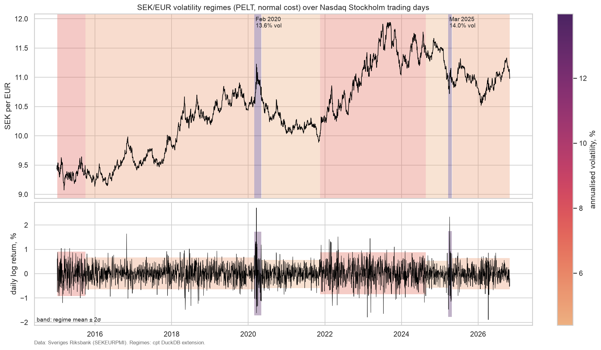
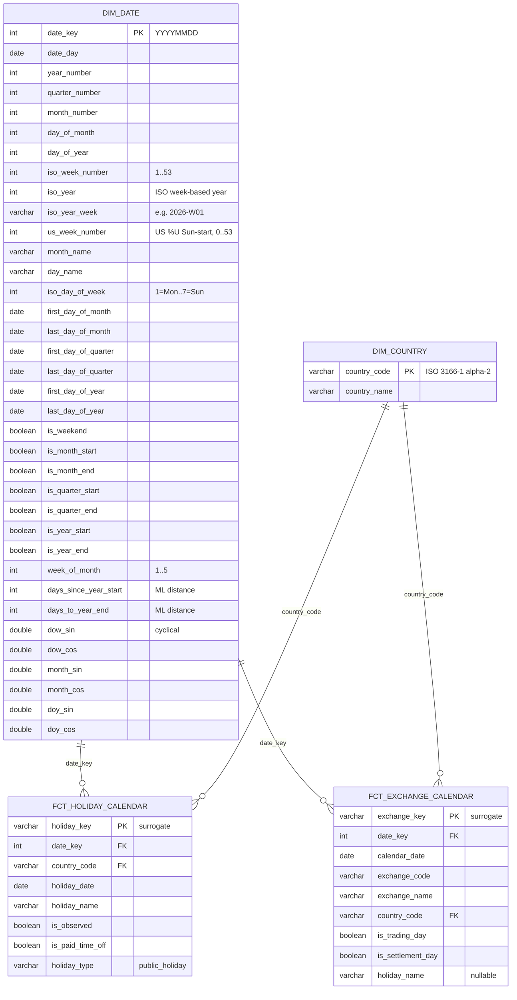
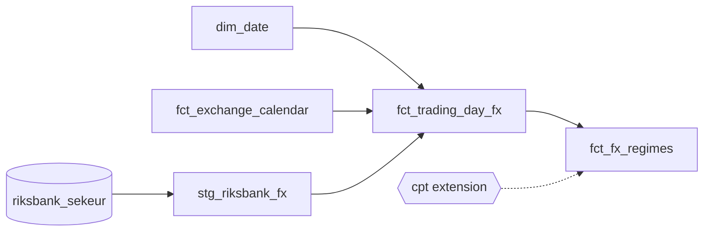
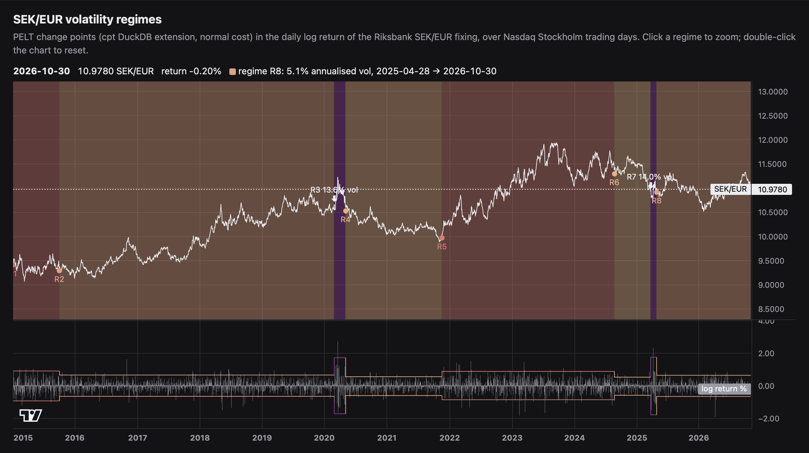

# dbt-duckdb-trading-calendar

<!-- BADGES:START -->
<!-- auto-generated by scripts/update_extension_badges.py — do not edit between these markers -->
| Badge | What it tracks |
| --- | --- |
| [](https://github.com/oluies/dbt-duckdb-trading-calendar/actions/workflows/ci.yml) | **CI** — `dbt build` + test against SQL Server 2022 on every push / PR |
| [](https://github.com/oluies/dbt-duckdb-trading-calendar/actions/workflows/elementary.yml) | **Elementary** — scheduled OSS data-observability HTML report |
| [](https://github.com/dbt-labs/dbt-core) | **dbt-core** `1.12.3` — pinned in `requirements.txt` |
| [](https://github.com/duckdb/dbt-duckdb) | **dbt-duckdb** adapter `1.11.1` — pinned in `requirements.txt` |
| [](https://duckdb.org) | **DuckDB** engine `v2.0.0` |
| [](https://duckdb.org/docs/stable/core_extensions/httpfs/overview) | **httpfs** core extension — reads the remote Parquet over HTTPS — installed `77392a7207` |
| [](https://duckdb.org/docs/stable/core_extensions/azure) | **azure** core extension — Azure blob storage access for the Open Datasets feed — installed `906e92458c` |
| [](https://github.com/hugr-lab/mssql-extension) | **mssql** community extension — `ATTACH`es SQL Server so dbt writes the marts there — installed `v0.3.0` |
<!-- BADGES:END -->

A dbt project that builds a **date dimension** plus a **normalized,
Kimball-style holiday and exchange calendar** in SQL Server 2022,
using **DuckDB** (via `dbt-duckdb`) as the compute engine.

DuckDB reads the public Azure Open Datasets _Public Holidays_ Parquet
directly from blob storage and writes the resulting tables into a
SQL Server database (`Referensdata.azuredl`) over the DuckDB **mssql**
extension's `ATTACH`.

**Change point example.** An optional set of models puts the calendar to
work on a market series. It splits the SEK/EUR exchange rate into
volatility regimes with the [`cpt`](https://github.com/hugr-lab/duck-changepoint)
DuckDB extension, indexed on Nasdaq Stockholm trading days. See
[Change point example](#change-point-example-with_changepoint) for the
models, a walkthrough of the code and how to run it. The interactive
version (Scala.js + Laminar over TradingView Lightweight Charts) is live
at **<https://oluies.github.io/dbt-duckdb-trading-calendar/>**.

[](#change-point-example-with_changepoint)

### DuckDB extensions

The three `ext:` badges above track the extensions this project loads
(see `profiles.yml`): `httpfs` + `azure` (core) pull the source Parquet
from Azure blob storage over HTTPS, and `mssql` (community) `ATTACH`es
SQL Server so dbt writes the marts there.

The badge versions are **commit hashes**, not release tags (e.g. `mssql`
`da0204c` is release v0.2.0). They are regenerated from the live
`duckdb_extensions()` catalog by `scripts/update_extension_badges.py` —
run on every push and on a weekly schedule by
[`.github/workflows/badges.yml`](.github/workflows/badges.yml), which
commits any change back to `main`. So the table refreshes automatically
when we bump a pin in `requirements.txt` or when an extension build
updates upstream. To check the versions yourself:

```sql
INSTALL mssql FROM community; LOAD mssql;
UPDATE EXTENSIONS;            -- name, repo, update_result, prev/current version
-- or, for install path + load state:
SELECT extension_name, extension_version, installed, loaded
FROM duckdb_extensions()
WHERE extension_name IN ('httpfs', 'azure', 'mssql');
```

> The `dev` profile runs with `threads: 4`. The community `mssql`
> extension is thread-safe since its "Thread-safe catalog entry
> lifetime" fix (hugr-lab/mssql-extension PR #127); on DuckDB 2.0.0,
> `INSTALL mssql FROM community` resolves to v0.3.0, which includes it.
> Builds up to v0.2.0 crashed intermittently (exit 139) at two or more
> threads; if that comes back, drop to `threads: 1`. See the `threads`
> comment in `profiles.yml`.

---

## Setup

### 1. Prerequisites

- Docker (with `docker compose`)
- Python 3.10+
- On macOS the default compose file uses the official
  `mcr.microsoft.com/mssql/server:2022-latest` image which is linux/amd64.
  On Apple Silicon you can either let Docker Desktop emulate it via
  Rosetta, **or** pass `PLATFORM=arm-mac` to use the native arm64
  Azure SQL Edge image (see below).

### 2. Configure the SA password

```bash
cp .env.example .env
# edit .env -- replace SA_PASSWORD with something strong, e.g.:
#   openssl rand -base64 32 | tr -d '/+=' | cut -c1-24
```

The password must satisfy SQL Server's complexity rules (>= 8 chars,
contains three of: upper, lower, digit, non-alphanumeric).
`.env` is gitignored.

### 3. Start SQL Server and create the database + schema

**Default (linux/amd64 — works on Linux and via Rosetta on Macs):**

```bash
make db-up
make db-init
```

**Apple Silicon native (Azure SQL Edge, linux/arm64):**

```bash
make PLATFORM=arm-mac db-up
make PLATFORM=arm-mac db-init
```

> Caveat: Azure SQL Edge has been announced end-of-support by Microsoft
> (Sep 2025). It remains the only native arm64 option for dev as of
> 2026, and `dbt-duckdb`'s mssql ATTACH talks to it over the same wire
> protocol unchanged. Don't use it for production.

`db-init` creates a `Referensdata` database and an `azuredl` schema.
dbt creates and drops the **tables** inside that schema; the schema
itself is created here so no model needs `CREATE SCHEMA` privileges.

`db-init` runs `scripts/db_init.py` on the host, which connects through
DuckDB's `mssql` extension (`mssql_exec`) rather than `sqlcmd` in the
container (`azure-sql-edge:latest` no longer ships `sqlcmd`). It needs
the `duckdb` package, so create the venv from step 4 first, or point
`make PYTHON=...` at an interpreter that has it.

### 4. Install dbt and run

```bash
python -m venv .venv && source .venv/bin/activate
pip install -r requirements.txt

# profiles.yml lives in the repo root; tell dbt to look there.
export DBT_PROFILES_DIR=$PWD

dbt deps
dbt seed
dbt run
dbt test
```

The full end-to-end sequence:

```bash
make db-up && make db-init && \
  dbt deps && dbt seed && dbt run && dbt test
```

(prefix the `make` commands with `PLATFORM=arm-mac` on Apple Silicon).

### 5. Browse the marts (optional)

To explore the resulting tables in `Referensdata.azuredl` with a web SQL
client + table browser, use the opt-in **DBGate** service (open source, MIT).

**One command** (starts SQL Server, builds the marts into a local `.venv`,
launches DBGate, opens the browser, then prints the tables). It picks the
DB image by CPU architecture -- native arm64 Azure SQL Edge on Apple
Silicon, SQL Server on amd64:

```bash
scripts/view-marts.sh          # macOS / Linux
scripts\view-marts.ps1         # Windows (PowerShell)

scripts/view-marts.sh down     # tear it all down (down also works on .ps1)
```

**Or wire it up by hand** with the Makefile (assumes you have already run
`dbt seed`/`dbt run`):

```bash
make db-up        # if SQL Server isn't already running
make db-viewer    # starts DBGate, opt-in compose profile "tools"
# open http://localhost:8085  -- auto-connected as "Referensdata"
make db-viewer-down   # stop + remove the viewer when done
```

DBGate runs alongside SQL Server in docker-compose (it is **not** started
by `make db-up`). It auto-connects to the `mssql` service; `USE_SSL` +
`SSL_TRUST_CERTIFICATE` mirror the dbt profile's
`Encrypt=yes;TrustServerCertificate=yes` so it trusts SQL Server's
self-signed dev certificate. It opens focused on `Referensdata`; you can
run ad-hoc SQL or click through `azuredl.*` tables.

---

## Data model

Normalized, Kimball-style. **No** wide per-country boolean columns on
`dim_date`.



- **`stg_public_holidays`** – staging view of the Azure parquet, filtered
  to the country codes in `var('holiday_country_codes')`.
- **`stg_date_spine`** – ephemeral daily spine 2015-01-01 .. 2035-12-31
  from `dbt_utils.date_spine`.
- **`dim_date`** – country-agnostic, one row per day. `iso_day_of_week`
  uses DuckDB's `isodow()`, which always returns 1=Monday..7=Sunday and
  does NOT depend on any `SET DATEFIRST` / locale setting. ISO 8601
  week semantics are completed by `iso_week_number`, `iso_year`, and
  the text key `iso_year_week` ('2026-W01'). ISO 8601 is the convention
  for Sweden/EU and trading use; `us_week_number` additionally carries
  the US/Sunday-start convention (`strftime %U`, range 0..53, where days
  before the first Sunday of the year fall in week 0). Unlike ISO, US
  weeks never cross the year boundary, so `year_number` is the matching
  week-year and there is no separate US week-year column.

  Includes **ML feature columns** alongside the standard dim columns:

  - cycle-position booleans: `is_month_start`, `is_month_end`,
    `is_quarter_start`, `is_quarter_end`, `is_year_start`, `is_year_end`,
    plus `week_of_month` (1..5).
  - distance integers: `days_since_year_start`, `days_to_year_end`
    (both 0 on their boundary day).
  - cyclical encodings: `dow_sin/cos`, `month_sin/cos`, `doy_sin/cos`.
    Each `(sin, cos)` pair maps an ordinal onto the unit circle so the
    first and last value of the cycle sit adjacent (Sun -> Mon = 1 step,
    Dec -> Jan = 1 step) instead of being maximally apart. Useful for
    linear models, and as input features for tree models that don't
    natively model cycles. Day-of-year uses period 365.25 to average
    across the leap cycle. See scikit-learn's [Time-related feature
    engineering](https://scikit-learn.org/stable/auto_examples/applications/plot_cyclical_feature_engineering.html)
    example for the canonical pattern.

  We deliberately do NOT one-hot day_name / month_name / quarter into
  the dim -- modern ML frameworks accept integers, and one-hot at the
  warehouse layer couples the schema to a specific feature pipeline.
- **`dim_country`** – seeded from `seeds/dim_country.csv`. One row per
  country in `var('holiday_country_codes')`.
- **`fct_holiday_calendar`** – grain `(holiday_date, country_code)`.
  Surrogate `holiday_key` via `dbt_utils.generate_surrogate_key`.
  `holiday_type` always equals `'public_holiday'` for Azure rows; the
  column exists so de-facto / bank holidays can be unioned in later.
- **`fct_exchange_calendar`** – grain `(calendar_date, exchange_code)`.
  Seeded from `seeds/exchange_holidays.csv`. Lists **exception days
  only** (full closures + half-day sessions); ordinary trading days
  are inferred from "no row" plus `dim_date.is_weekend`.

The seed is pre-populated with **Nasdaq Stockholm (XSTO)** exception
days for 2024–2026 as a worked example.

### Using the cyclical encodings

The `(sin, cos)` pairs (`dow_sin/cos`, `month_sin/cos`, `doy_sin/cos`) place
each ordinal on the unit circle at angle `2*pi*(n-1)/period`, so cycle-adjacent
values are adjacent in feature space (Sun→Mon, Dec→Jan = one step). **Always
use both columns of a pair** — a lone `sin` is ambiguous (two phases share a
value); the pair is unique, like `(x, y)` on the circle.

**For ML** they give a model a smooth, wrap-aware view of calendar phase:

- Linear / logistic / GLM and neural nets can't express "December is next to
  January" from a raw `month_number`; the pair turns it into a smooth periodic
  signal. Add harmonics (`sin`/`cos` of 2×, 3× the angle) for richer seasonal
  shape.
- Distance / kernel models (kNN, k-means, RBF-SVM) get a Euclidean distance on
  the pair that respects cyclic proximity.
- Tree ensembles (RandomForest, XGBoost, LightGBM) can already split the raw
  integers, so the encodings are optional there — harmless, sometimes a small
  help. This is why the dim keeps **both** the raw ordinals and the encodings.

**For SQL / human analysis** a raw `0.43` isn't human-readable — for eyeballing
use `day_of_week` / `month_number` / the `is_*` flags. The pair is for cyclic
math:

```sql
-- phase angle in radians for the weekly cycle (0 = Monday)
atan2(dow_sin, dow_cos)                          AS dow_angle

-- cyclic similarity between two rows' weekly phase: the dot product of the
-- unit vectors -> 1 = same phase, 0 = a quarter-cycle apart, -1 = opposite
a.dow_sin * b.dow_sin + a.dow_cos * b.dow_cos    AS phase_cos_sim
```

They are **feature columns, not window-frame keys**: window functions still
`ORDER BY date_day`. The encodings feed seasonal features *inside* those windows
(rolling models, lagged features); they don't define the frame bounds.

**For changepoint detection (PELT and friends)** detectors like PELT (e.g.
Python [`ruptures`](https://centre-borelli.github.io/ruptures-docs/)), Binary
Segmentation, or Bayesian online changepoint detection find where a series'
statistics shift. Run naively on a seasonal metric they fire on the season
itself (every December). Use the cyclical features to remove that: regress your
metric on them (plus harmonics) and run the detector on the **residual** to
surface genuine regime changes; or pass them as covariates to a multivariate
detector so the expected seasonal mean-shift isn't flagged. The encodings model
seasonality cleanly — they are not changepoints themselves.

### Why normalized?

- **Scales to N countries with no schema change.** Wide per-country
  boolean columns (`is_holiday_se`, `is_holiday_no`, …) require a
  schema migration every time a new country is added and force a
  costly join-by-pivot for "what's a holiday today across our markets?"
- **Plays nicely with exchange calendars.** National public holidays
  and exchange closures aren't the same set — Swedish exchanges close
  on **midsommarafton** (not a Swedish public holiday) and trade
  half-days on certain eves. They need their own fact table; a
  per-country boolean on `dim_date` can't express that.
- **Future-proof for subdivision calendars.** Adding ISO 3166-2 level
  data (state/canton/county holidays) is a straight repeat of the same
  pattern: a `dim_subdivision` table keyed `(country_code,
  subdivision_code)` and a `fct_subdivision_holiday` fact with grain
  `(holiday_date, country_code, subdivision_code)`. Not built here;
  noted for later.

---

## Tests (`dbt test`)

`models/schema.yml` covers:

- `dim_date` – unique + not_null on `date_key`, `date_day`;
  `iso_day_of_week` in 1..7; `us_week_number` in 0..53. A singular test
  (`tests/assert_dim_date_week_numbers.sql`) also pins the ISO and US
  week columns to hand-verified values for well-known edge-case dates
  in `seeds/expected_week_numbers.csv`.
- `dim_country` – unique + not_null on `country_code`;
  `accepted_values` matching `var('holiday_country_codes')`
- `fct_holiday_calendar` – not_null on `date_key`, `country_code`,
  `holiday_date`; unique combination `(holiday_date, country_code)`;
  relationships to `dim_date` and `dim_country`;
  `accepted_values` on `holiday_type`
- `fct_exchange_calendar` – unique combination `(calendar_date,
  exchange_code)`; relationships on `date_key` and `country_code`
- The change point models carry their own tests in
  `models/changepoint/schema.yml` and `tests/assert_fx_*.sql`; they run
  only with `with_changepoint: true` (see below).

## Change point example (`with_changepoint`)

An optional example that puts the calendar to work on a market series:
it finds **volatility regimes in the SEK/EUR exchange rate** with the
[`cpt`](https://github.com/hugr-lab/duck-changepoint) DuckDB extension
(PELT change point detection), indexed on Nasdaq Stockholm trading days.


The input is the Riksbank's daily SEK/EUR fixing (SWEA series
`SEKEURPMI`), frozen in `seeds/riksbank_sekeur.csv` so CI never calls the
rate-limited API. `scripts/fetch_riksbank_fx.py` refreshes it, and
[`.github/workflows/refresh-data.yml`](.github/workflows/refresh-data.yml)
does so every Monday: it fetches new fixings, rebuilds the models with their
tests, and commits the seed and the page's JSON only if everything passes.
The figures quoted in this README and `docs/fx_regimes.png` are a snapshot
from 30 October 2026.

| Model | Grain | What it does |
| --- | --- | --- |
| `stg_riksbank_fx` | fixing day | rate + log return vs. the previous fixing |
| `fct_trading_day_fx` | weekday | joins `dim_date`, the XSTO calendar and the fixing |
| `fct_fx_regimes` | regime | start/end date, trading days, mean return, daily and annualised volatility |



### How the code works

**1. Returns** ([`stg_riksbank_fx.sql`](models/changepoint/stg_riksbank_fx.sql)).
Change point detection wants a series whose behaviour is roughly
constant within a regime. The rate itself wanders, but its daily log
return does not, so the model takes the return against the previous
*fixing* (not the previous calendar day):

```sql
100 * ln(sek_per_eur / lag(sek_per_eur) over (order by rate_date)) as log_return_pct
```

**2. Calendar join** ([`fct_trading_day_fx.sql`](models/changepoint/fct_trading_day_fx.sql)).
One row per weekday from `dim_date`, left-joined to the XSTO exception
days and the fixing. The exchange seed lists exceptions only, so a
weekday with no row is a trading day, but only in years the seed covers.
Elsewhere `is_xsto_trading_day` is NULL rather than a misleading `true`:

```sql
case
    when cy.year_number is null then null          -- year not in the seed
    else coalesce(x.is_trading_day, true)          -- no exception row = open
end as is_xsto_trading_day
```

**3. Detection** ([`fct_fx_regimes.sql`](models/changepoint/fct_fx_regimes.sql)).
`cpt` works on a whole series at once, so the returns are collected into
a `DOUBLE[]` in date order, together with a parallel list of dates.
`cpt_pelt` returns the 1-based positions where segments end;
`cpt_segment_stats` turns those into one struct per segment (start, end,
mean, sample variance, length); `unnest` makes it one row per regime;
and indexing the date list maps positions back to calendar dates
(simplified; the model reads the penalty and minimum length from vars):

```sql
with series as (
    select list(log_return_pct order by date_day) as xs,
           list(date_day       order by date_day) as days
    from returns
),
segments as (
    select days,
           unnest(cpt_segment_stats(xs, cpt_pelt(xs, 'normal', 'mbic', 20))) as seg
    from series
)
select days[seg.start] as start_date,
       days[seg."end"] as end_date,
       seg.n           as trading_days,
       sqrt(seg.var * 252) as annualised_vol_pct
from segments
```

The `normal` cost detects changes in mean *and* variance. FX returns keep
a mean near zero, so what it finds are volatility shifts: COVID in spring
2020 (13.6 % annualised) and the April 2025 tariff shock (14.0 %),
against 4–7 % in calm regimes. The penalty sets how much a new break
must improve the fit before it is kept: `cpt_penalty` defaults to `mbic`
(R changepoint's convention; `bic`, `aic` or a number also work), and
`cpt_min_regime_days` (default 20) stops one wild week from becoming a
regime of its own. Raise either and fewer regimes survive.

Lists and structs never leave DuckDB: the query computes everything,
then only scalar columns are written to SQL Server, so the table
materialises in `Referensdata` like the rest of the project.

**4. Loading the extension** (`profiles.yml`).
`cpt` is a signed [community extension](https://duckdb.org/community_extensions/),
so it is listed under `extensions:` in the `dev` target, next to `mssql`.
dbt-duckdb runs `INSTALL cpt FROM community` and `LOAD cpt` when it connects.

**5. Chart** ([`scripts/plot_fx_regimes.py`](scripts/plot_fx_regimes.py)).
It reads `fct_trading_day_fx` and `fct_fx_regimes` back from SQL Server
through DuckDB's `mssql` extension and draws the figure above with
seaborn. The top panel shows the rate with each regime shaded by
volatility, and the bottom panel shows the returns with each regime's
mean ± 2σ band.

**6. Interactive chart** ([`scripts/chart_fx_regimes_tv.py`](scripts/chart_fx_regimes_tv.py)).
The same data drawn with [TradingView Lightweight Charts](https://www.tradingview.com/lightweight-charts/)
(Apache-2.0) into one self-contained page, [`docs/fx_regimes.html`](docs/fx_regimes.html).
The data is embedded and the library loads from unpkg at a pinned version.
The page has a crosshair legend (date, rate, return, regime), a marker at
each regime start, and a regime table: click a row to zoom to that
regime, double-click the chart to reset. GitHub does not render HTML in
place, so download the file or open it from a clone.

[](docs/fx_regimes.html)

Lightweight Charts has no built-in background bands, so each regime is
its own `AreaSeries` with value 1 on a hidden overlay price scale pinned
to 0–1. A histogram would leave gaps between bars once ~3,000 days are
squeezed into under one pixel each. Each band starts at the fixing
*before* its first return, because a daily return covers the interval
since the previous fixing; that way neighbouring bands meet. Both chart
scripts read the tables through
[`scripts/fx_regimes_db.py`](scripts/fx_regimes_db.py).

**7. Scala.js + Laminar app** ([`web/`](web/)).
The same chart as a [Scala.js](https://www.scala-js.org/) application
with a [Laminar](https://laminar.dev) UI, over Lightweight Charts. It
loads the regimes from `fx_regimes.json`, so it can be redeployed with
fresh data without recompiling.

| File | What it holds |
| --- | --- |
| [`LightweightCharts.scala`](web/app/src/LightweightCharts.scala) | A typed facade for the few Lightweight Charts calls the app makes (`@JSGlobal("LightweightCharts")`, the standalone build `index.html` loads) |
| [`Model.scala`](web/app/src/Model.scala) | `Day`, `Regime`, `FxData`: JSON parsing, the stress rule (≥ 2× the median volatility, as in the dbt test) and the volatility colour ramp |
| [`RegimeChart.scala`](web/app/src/RegimeChart.scala) | The chart: regime bands, rate, returns with the ±2σ band, markers. Colours are re-read from the page's CSS tokens when the theme changes, and the listeners are removed on unmount |
| [`Main.scala`](web/app/src/Main.scala) | The Laminar view: `FetchStream` loads the data into a `Signal`; the legend follows a `Var` fed by the crosshair; clicking a table row sets the selected regime, and the chart zooms to it |

The chart is mounted with `onMountUnmountCallbackWithState`, so the
Lightweight Charts instance lives exactly as long as its DOM node, and
the zoom subscription uses the element's owner.

```bash
uv run scripts/export_fx_regimes_json.py   # web/public/fx_regimes.json
cd web && make dist                        # Mill links main.js; site in web/dist/
make serve                                 # http://localhost:8099
```

`web/dist/` is a static site (`index.html`, `main.js`,
`fx_regimes.json`). [`.github/workflows/pages.yml`](.github/workflows/pages.yml)
builds it and deploys it to GitHub Pages,
<https://oluies.github.io/dbt-duckdb-trading-calendar/>, on every push to
`main` that touches `web/`. The `web` job in `ci.yml` builds the same site
on every PR, and runs [`scripts/check_contrast.py`](scripts/check_contrast.py), which checks
every colour palette in `web/index.html` against WCAG 2.1 AA (text 4.5:1;
chart lines, regime colours and focus rings 3:1).

The page has a **Background** picker (Auto, White, Light grey, Dark grey,
Black). Auto follows the host's `data-theme`, then the OS setting; a choice
is remembered in the browser. The regime table is keyboard operable (each
regime is a button), **Show all** resets the zoom, and the chart carries a
text alternative that points to the table.

The build uses Scala 3.3 LTS, Scala.js 1.22 and Laminar 17.2, with Mill 1.3
through the `web/mill` launcher, so only a JDK is needed.

**Try other parameters.** On the GitHub Pages site, the panel under the
chart reruns the detection in the reader's browser. Choose a penalty (MBIC,
BIC, AIC or a custom β) and a shortest regime length, and the chart and
table update as the controls move. Nothing downloads until the reader
presses **Load DuckDB** (about 7 MB).

[`web/duckdb-bridge.js`](web/duckdb-bridge.js) starts
[DuckDB-WASM](https://github.com/duckdb/duckdb-wasm) and loads
`web/public/cpt.duckdb_extension.wasm`, the `wasm_eh` build from the
duck-changepoint CI. The DuckDB-WASM version is pinned because the extension
needs DuckDB 2.0 and npm's `latest` tag is still 1.5.4.
[`Live.scala`](web/app/src/Live.scala) holds the panel. With the published
settings, the browser reproduces all 8 regimes from the dbt build, with the
same dates and lengths. The Claude artifact copy of the page cannot run the
engine, because its content policy blocks it, so there the panel links to the
Pages site.

### Tests

The calendar is the index, and it is checked against the data:
[`tests/assert_fx_fixings_match_xsto_calendar.sql`](tests/assert_fx_fixings_match_xsto_calendar.sql) asserts that, in years
the exchange seed covers, the Riksbank publishes on exactly the XSTO
trading days. That test caught New Year's Eve, which the seed listed as
a half-day session; Nasdaq Stockholm is closed on 31 December. Two more
tests check that the regimes tile the return series
([`assert_fx_regimes_tile_series.sql`](tests/assert_fx_regimes_tile_series.sql)),
and that the 2020 and 2025 stress dates fall in regimes with at least
twice the median volatility
([`assert_fx_stress_dates_in_high_vol_regimes.sql`](tests/assert_fx_stress_dates_in_high_vol_regimes.sql)).
The second fails if the penalty is set so high that the stress episodes
merge into calm regimes.

### Running it

`profiles.yml` installs `cpt` from the DuckDB community repository, so there
is nothing to build.

```bash
dbt build --vars '{with_changepoint: true}' --select tag:changepoint
uv run scripts/plot_fx_regimes.py        # writes docs/fx_regimes.png
uv run scripts/chart_fx_regimes_tv.py    # writes docs/fx_regimes.html
```

CI runs these models after the main build.

---

## Observability (Elementary OSS)

The [`elementary-data/elementary`](https://docs.elementary-data.com/oss/oss-introduction)
package is wired up but **disabled by default**. The
`.github/workflows/elementary.yml` workflow flips the gating var
(`with_elementary: true`), builds elementary's tables into
`Referensdata.elementary`, and publishes the resulting HTML report
(models, tests, lineage, run history) as a workflow artifact.

Triggered manually (`workflow_dispatch`), on push to `main`, and on a
weekly schedule. The main `ci.yml` is unaffected.

To generate locally:

```bash
pip install -r requirements-elementary.txt
dbt deps
dbt seed --vars '{with_elementary: true}'
dbt run  --vars '{with_elementary: true}'
dbt test --vars '{with_elementary: true}' || true
dbt run  --select package:elementary --vars '{with_elementary: true}'
edr report --profiles-dir "$PWD" --profile-target dev \
  --file-path elementary-report/index.html
open elementary-report/index.html
```

You'll need to pre-create the schema once:

```sql
USE Referensdata;
IF NOT EXISTS (SELECT 1 FROM sys.schemas WHERE name = N'elementary')
    EXEC('CREATE SCHEMA elementary');
```

---

## Nightly mssql-extension stress test (archived)

`.github/workflows/duckdb-mssql-nightly.yml.disabled` is a dormant
harness for re-running the full pipeline at `threads=4` and `threads=8`
against a freshly built `mssql.duckdb_extension` pulled from upstream
[`hugr-lab/mssql-extension`](https://github.com/hugr-lab/mssql-extension)
CI artifacts. The goal was to validate
[PR #127](https://github.com/hugr-lab/mssql-extension/pull/127)
("Thread-safe catalog entry lifetime") before it ships in a tagged
community-repo release.

It is **disabled** because DuckDB extensions are ABI-coupled to
libduckdb, and the upstream build is against a duckdb-main snapshot
(commit `f480e78`, 2026-02-13) -- not the released `2.x` line we
get from pip. Loading the upstream binary into pip's duckdb fails
with "extension built for different DuckDB version". Two dispatched
runs (on DuckDB 1.5.x) confirmed this.

**Reactivate** by renaming the file back to `.yml` once the upstream
fix lands in a tagged community release -- at that point the workflow's
premise (pre-place a freshly built binary) is no longer needed, and
the simpler path is to bump `profiles.yml`'s `dev` target from
`threads: 1` to `threads: 4`.

The `nightly` profile target in `profiles.yml` is kept as a local
convenience for `DBT_THREADS=N dbt run --target nightly` once the
fix is in the released community extension.

---

## Notes / decisions

### Source of holiday data

The project ships with the **Azure Open Datasets _Public Holidays_**
parquet. License: **CC BY-SA 3.0 (ShareAlike)**. It's a frozen
**1970–2099 snapshot** maintained by Microsoft, originally derived
from the same underlying Python `holidays` package.

The MIT-licensed [`holidays`](https://pypi.org/project/holidays/) PyPI
package is the same upstream source but is _current_ rather than
frozen, and would be a defensible swap if you need:

- continuously updated holiday data after the frozen snapshot ages,
- a more permissive license (MIT vs. CC BY-SA 3.0),
- subdivision-level (ISO 3166-2) holidays out of the box.

To swap: replace `stg_public_holidays.sql` with a Python model
(dbt-duckdb supports Python models) that imports `holidays`, builds
a DataFrame keyed `(country_code, date)`, and exposes the same
columns. The downstream model (`fct_holiday_calendar`) doesn't need
to change. We've kept the Azure source here because the requirement
calls for it; the rest of the pipeline is source-agnostic.

### iso_day_of_week and SET DATEFIRST

SQL Server's `DATEPART(weekday, …)` depends on the connection's
`SET DATEFIRST` value, which makes any column computed from it
non-portable. We compute `iso_day_of_week` in DuckDB using `isodow()`,
which is locale-independent and standards-aligned (ISO 8601:
1=Monday..7=Sunday). The integer is then written into SQL Server
as plain `INT`, so consumers can read it without ever issuing a
`SET DATEFIRST`.

### Schema management

- The schema `Referensdata.azuredl` is created by `make db-init` and
  is NOT created by any dbt model. dbt only manages **tables** inside
  it (create/drop). This avoids the SA-only-on-bootstrap surprise of
  bare `CREATE SCHEMA` statements inside models.

### Future extensions

- `dim_subdivision` + `fct_subdivision_holiday` keyed on
  `(country_code, subdivision_code)` for ISO 3166-2 sub-national
  calendars (German Länder, US states, UK constituent countries with
  separate bank holidays). Same shape as the country pair; not built
  now.
- A `dim_exchange` would naturally pair with the existing exchange
  fact once more than one exchange is in scope.

---

## Repo layout

```
.
├── .env.example              # template; copy to .env and edit
├── .gitignore
├── docker-compose.yml        # default (linux/amd64 SQL Server 2022)
├── docker-compose.arm.yml    # PLATFORM=arm-mac (linux/arm64 Azure SQL Edge)
├── Makefile                  # db-up / db-down / db-shell / db-init
├── requirements.txt          # dbt-core, dbt-duckdb
├── packages.yml              # dbt_utils
├── dbt_project.yml
├── profiles.yml              # uses DBT_PROFILES_DIR=$PWD
├── models/
│   ├── schema.yml
│   ├── staging/
│   │   ├── stg_public_holidays.sql
│   │   └── stg_date_spine.sql
│   ├── marts/
│   │   ├── dim_date.sql
│   │   ├── fct_holiday_calendar.sql
│   │   └── fct_exchange_calendar.sql
│   └── changepoint/          # with_changepoint: SEK/EUR volatility regimes
│       ├── schema.yml
│       ├── stg_riksbank_fx.sql
│       ├── fct_trading_day_fx.sql
│       └── fct_fx_regimes.sql
├── scripts/
│   ├── fetch_riksbank_fx.py  # refresh seeds/riksbank_sekeur.csv
│   ├── fx_regimes_db.py      # reads the regime tables for both charts
│   ├── plot_fx_regimes.py    # docs/fx_regimes.png (seaborn)
│   ├── chart_fx_regimes_tv.py  # docs/fx_regimes.html (Lightweight Charts)
│   └── export_fx_regimes_json.py  # web/public/fx_regimes.json
├── web/                      # Scala.js + Laminar version of the chart (Mill)
└── seeds/
    ├── dim_country.csv
    ├── exchange_holidays.csv
    └── riksbank_sekeur.csv
```
